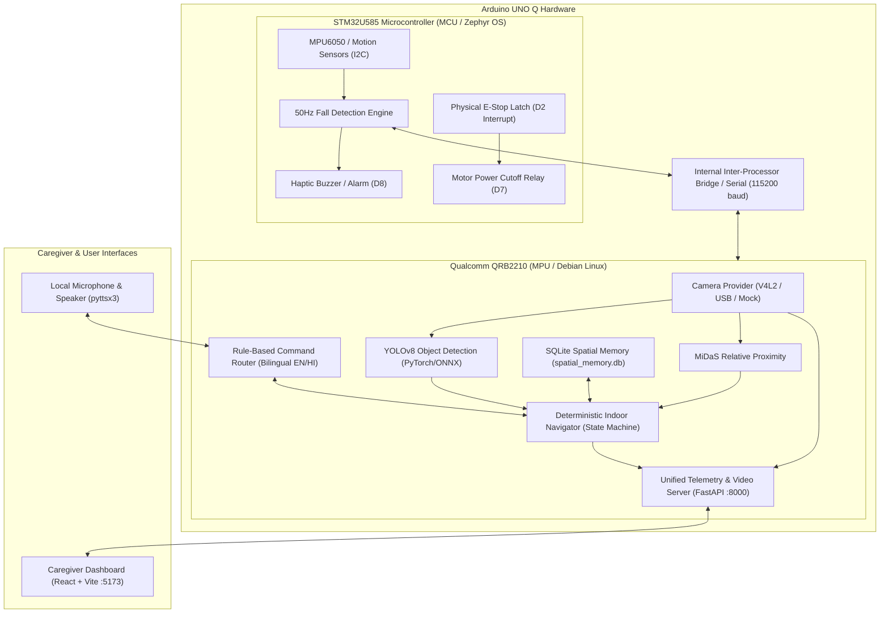

# SURDAS UNO Q — Assistive Vision & Navigation System

[](https://github.com/devanshvpurohit/VNR/actions/workflows/uno_q_ci.yml)


SURDAS is an integrated, deterministic assistive vision and navigation platform re-architected for the **Arduino UNO Q** hybrid single-board computer.

The system combines high-level computer vision, spatial memory, and deterministic guidance running on the **Qualcomm QRB2210 Linux MPU** with real-time motion acquisition and low-latency safety controls executing on the **STM32U585 Microcontroller (MCU)**.

> [!IMPORTANT]
> **Key Architecture Changes in Arduino UNO Q Remake:**
> - **Zero ESP32 runtime dependencies:** Replaced ESP32-CAM and ESP32-IMU HTTP endpoints with a native Linux Hardware Abstraction Layer (V4L2/USB auto-discovery) and STM32 firmware bridge.
> - **Zero Ollama / LLM dependencies:** Replaced conversational LLM processing with a deterministic rule-based command router, spatial queries, and safety-validated state machines.
> - **Unified Local Telemetry & Static Dashboard:** Live video streaming, REST API, WebSockets, sensor monitoring, and the compiled React Caregiver Dashboard are served directly on port `8000` (no external servers or cloud accounts required).
> - **Hardware Abstraction Layer (HAL):** Modular providers with clean mock fallbacks allow full development, testing, and UI preview without attached hardware.
> - **Automated GitHub Deployment:** Includes systemd service units, provisioning scripts, and GitHub Actions CI. See [DEPLOYMENT.md](DEPLOYMENT.md).

---

## 🏛️ System Architecture



---

## ⚙️ Target Environments & Work division

### 1. Linux MPU Computing (`Qualcomm QRB2210 / Debian Linux`)
- **Python Application Runtime**: Main orchestrator (`surdas_brain.py`).
- **Camera Ingestion**: OpenCV / V4L2 device auto-discovery (`/dev/video*`) with graceful disconnection recovery and synthetic mock camera fallback (`hal/camera.py`).
- **Object & Obstacle Detection**: YOLOv8n inference with bounding boxes and confidence filtering (`hal/vision.py`).
- **Relative Depth Perception**: MiDaS relative inverse depth classification (`VERY_CLOSE`, `CLOSE`, `MEDIUM`, `FAR`). *Relative inverse depth, not metric distance.*
- **Deterministic Indoor Navigation**: State machine (`IDLE`, `NAVIGATING`, `SAFETY_HOLD`, `APPROACHING`, `ARRIVED`) in `indoor_navigator.py`.
- **Persistent Spatial Memory**: SQLite storage for rooms, landmarks, objects, and spatial relationships (`spatial_memory.py`).
- **Rule-Based Bilingual Voice Assistant**: English and Hindi command recognition and spoken guidance via `pyttsx3` (`voice/command_router.py`).
- **Caregiver Telemetry Service**: FastAPI backend serving REST endpoints (`/health`, `/imu`, `/location`), WebSocket events (`/ws`), and MJPEG preview (`/video_feed`).

### 2. Microcontroller Control (`STM32U585 / Arduino Core`)
- **Deterministic Sensor Acquisition**: 50Hz MPU6050 reading over I2C.
- **Hardware Fall Detection**: Autonomous multi-stage state machine (`NORMAL` → `FREEFALL` → `IMPACT` → `FALL_CONFIRMED`).
- **Deterministic Safety Cutoff**: Physical E-Stop pin interrupt immediately disables motor relay and triggers buzzer alarm with zero dependency on the Linux OS.
- **Microcontroller Bridge**: Serial/RPC telemetry packets streamed at 10Hz to the Linux MPU. Firmware located in `sketch/uno_q_firmware/uno_q_firmware.ino`.

---

## 🚀 Quickstart & Deployment

Detailed instructions for deploying on physical Arduino UNO Q hardware are in [DEPLOYMENT.md](DEPLOYMENT.md).

### Automated Setup on Arduino UNO Q (Debian Linux)
```bash
# 1. Clone repository on the board
git clone https://github.com/devanshvpurohit/VNR.git /opt/surdas
cd /opt/surdas

# 2. Run automated bootstrap (installs apt packages, venv, dashboard build)
sudo ./scripts/install_uno_q.sh

# 3. Flash STM32 MCU & start background service
sudo ./scripts/flash_firmware.sh
sudo ./scripts/deploy_service.sh
```
Once deployed, open `http://<arduino-uno-q-ip>:8000` in any web browser to access the live Caregiver Dashboard!

### Hardware-Free Simulation / Local Development
You can run and verify the complete application without any physical sensors or cameras attached:

```bash
# 1. Install dependencies
pip install -r requirements.txt

# 2. Run in headless simulation mode:
python3 surdas_brain.py --headless --mock-camera --mock-sensors

# 3. Open http://localhost:8000 in your browser to view the Caregiver Dashboard
```
The FastAPI backend serves the pre-built React application directly from `caregiver_dashboard/dist` alongside WebSocket and MJPEG video streaming. (For dashboard development, run `npm run dev` in `caregiver_dashboard` to use Vite HMR on `:5173`).

---

## 🔌 Hardware Setup & Verification

### 1. Connecting a Camera on Arduino UNO Q
- Connect a standard UVC USB webcam to the Arduino UNO Q USB host port.
- Test camera detection:
  ```bash
  python3 -c "from hal.camera import scan_available_cameras; print(scan_available_cameras())"
  ```
- Specify an explicit camera device if multiple cameras are attached:
  ```bash
  python3 surdas_brain.py --camera /dev/video0
  ```

### 2. Flashing the STM32 Microcontroller
The Arduino UNO Q uses the **Arduino App Lab** or **Arduino CLI**:
```bash
# Using Arduino CLI:
arduino-cli compile --config-file sketch/sketch.yaml sketch/uno_q_firmware
arduino-cli upload -p /dev/ttyRPMSG0 --config-file sketch/sketch.yaml sketch/uno_q_firmware
```

#### Pinout Configuration (Conflict-Free Header Mapping):
| Peripheral | Pin(s) on UNO Q | Protocol | Notes |
| :--- | :--- | :--- | :--- |
| **Emergency Stop Button** | **D2** (INT0) | External Interrupt | Active-low physical latch; instant power cutoff |
| **Motor Relay Cutoff** | **D7** | Digital Output | Active-high motor driver enable |
| **Haptic Buzzer** | **D8** | Digital Output | Audible safety & collision alarm |
| **Status LED** | **A0** | Digital Output | Reassigned to A0 to avoid SPI clock conflict |
| **SPI TFT Display (ST7789/ST7735)** | **D13** (SCK), **D11** (MOSI), **D10** (CS), **D9** (DC), **D6** (RST), **D5** (BL) | Hardware SPI | 5Hz live graphical dashboard |
| **I2C IMU (MPU6050/LSM6DSOX)** | **A4** (SDA), **A5** (SCL) | I2C (400 kHz) | 50Hz deterministic fall detection sampling |
| **UART GPS (NEO-6M / NEO-M8N)** | **D0** (RX), **D1** (TX) or `Serial1` | UART (9600 baud) | $GPRMC/$GPGGA parser; streams lat/lon/sats to bridge |

---

## 🎙️ Deterministic Voice Commands

SURDAS handles all voice interactions deterministically without requiring an LLM or network connection:

| Command (English) | Command (Hindi) | Action |
| :--- | :--- | :--- |
| *"Surdas, describe surroundings"* | *"क्या दिख रहा है"* | Reports detected objects and closest obstacle. |
| *"Surdas, what room is this?"* | *"यह कौन सा कमरा है"* | Queries SQLite spatial memory for current room. |
| *"Surdas, remember this room as bedroom"* | *"इस कमरे को बेडरूम याद रखो"* | Saves room boundary to spatial memory. |
| *"Surdas, guide me to the chair"* | *"कुर्सी तक ले चलो"* | Initiates deterministic indoor navigation. |
| *"Surdas, pause navigation"* | *"नेविगेशन रोको"* | Transitions state to `SAFETY_HOLD`. |
| *"Surdas, resume navigation"* | *"नेविगेशन फिर से शुरू करो"* | Validates camera and resumes navigation. |
| *"Surdas, stop navigation"* | *"नेविगेशन बंद करो"* | Returns state to `IDLE`. |

---

## 📋 Feature Implementation Matrix

| Feature | Status | Notes |
| :--- | :--- | :--- |
| **OpenCV Camera Ingestion** | ✅ Verified | V4L2 device auto-discovery with synthetic mock fallback. |
| **YOLOv8 Object Detection** | ✅ Verified | YOLOv8n running with configurable confidence and latency logging. |
| **MiDaS Relative Depth** | ✅ Verified | Categorized into proximity bands; no false metric claims. |
| **Indoor Navigation** | ✅ Verified | Deterministic state machine with obstacle holds and arrival logic. |
| **Spatial Memory** | ✅ Verified | Offline SQLite database (`spatial_memory.db`) for rooms & landmarks. |
| **Deterministic Voice Routing** | ✅ Verified | Bilingual rule-based dispatcher; zero Ollama runtime requirement. |
| **Caregiver Dashboard** | ✅ Verified | Production React build with MJPEG feed, WebSocket telemetry, and E-Stop. |
| **Fall Detection** | 🟡 Simulated / Verified on MCU | Hardware state machine implemented in STM32 C++; simulated fallback clearly labeled `[SIMULATION]`. |
| **Emergency Stop** | ✅ Verified | Non-AI deterministic hardware cutoff and UI button. |
| **Outdoor GPS** | ⚪ Optional | Serial GPS driver preserved; falls back to manual test coordinates. |

---

## 🧪 Automated Testing

SURDAS includes a suite of 56 hardware-independent tests that execute in seconds without attached sensors or physical cameras:

```bash
# Run all tests:
pytest
```

Test coverage includes:
- `tests/test_camera_hal.py`: Auto-discovery, mock camera, failure handling, and frame acquisition.
- `tests/test_vision_hal.py`: Object detection output validation, depth map dimensions, and OCR.
- `tests/test_imu_hal.py`: Real vs simulated telemetry tagging, fall events, and missing hardware handling.
- `tests/test_bridge_hal.py`: Command dispatch, hardware E-Stop, and telemetry polling.
- `tests/test_indoor_nav.py`: Navigation state transitions, safety-hold triggers, and pause/resume/stop.
- `tests/test_spatial_mem.py`: SQLite spatial memory operations, room definitions, and landmark queries.
- `tests/test_voice_routing.py`: Rule-based deterministic command routing (English + Hindi) with NO Ollama calls.
- `tests/test_telemetry.py`: REST and WebSocket endpoints, MJPEG feed, and emergency stop endpoint.
- `tests/test_config.py`: Thresholds and configuration integrity.

---

## ⚠️ Known Limitations & Safety Advisory
1. **Relative Depth**: MiDaS estimates relative inverse depth, not calibrated metric distance. Obstacle distances must be treated as proximity heuristics.
2. **Fall Alerting**: Fall detection is an assistive alerting aid and is not certified for clinical diagnostic use.
3. **Collision Avoidance**: Navigation instructions are directional suggestions for user orientation. The system does not replace a white cane or guide dog.
